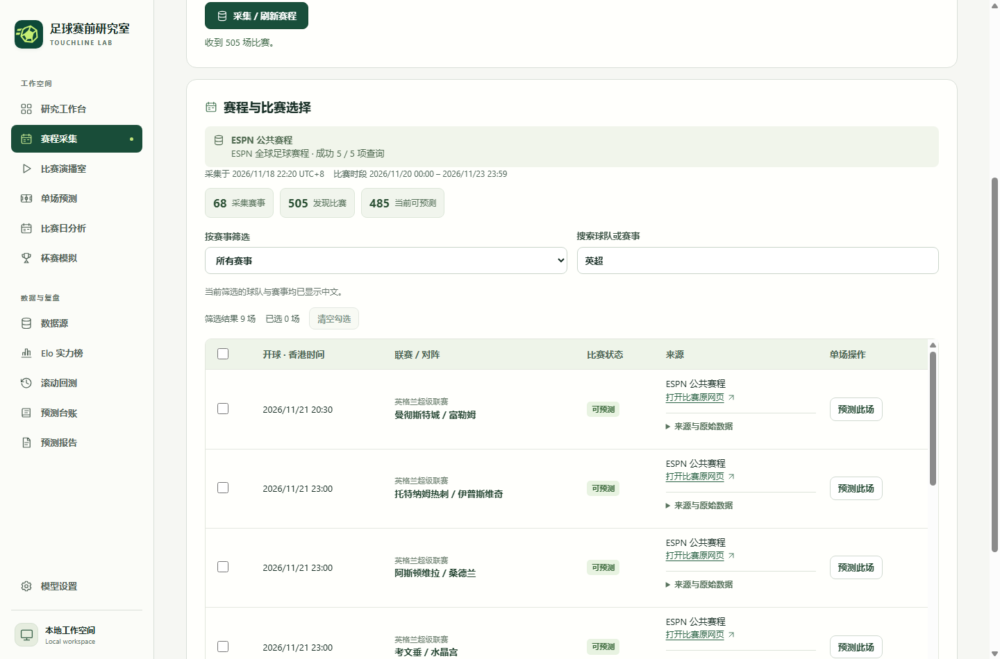

# Touchline Lab｜足球赛前研究室

中文 Windows 桌面软件与 Codex 足球预测 skill：自动采集赛程、选择比赛、计算预测、播放比赛动画、查看来源并复盘。

**[下载最新版本](https://github.com/nnnnompipo-glitch/football-match-prediction-skill/releases/latest)** · [Windows 64 位便携包 v2.2.0](https://github.com/nnnnompipo-glitch/football-match-prediction-skill/releases/download/v2.2.0/TouchlineLab-2.2.0-windows-x64.zip) · [桌面版说明](football-studio/README.md)

## Windows 桌面版

下载 ZIP 并解压，双击 `TouchlineLab.exe` 即可使用，无需安装 Python。在「赛程采集」中设置时段，选择单场、多场或本次收集的全部可预测比赛。设置页可以填写自己的大模型 API 地址、模型和密钥。

- 自动采集、中文队名与赛事名，支持「英超」「巴甲」「曼城」「大巴黎」等简称搜索，保留原名与来源链接。
- 比赛动画包含双方球员跑动、传球、抢断、射门及进球庆祝；比分取自预测分布，画面属于生成的比赛演绎。
- 历史战绩、伤停、赔率、情景重算、比分矩阵、杯赛、Elo、回测和冻结台账等模块可按需启用。
- 未取得通行译名的冷门名称先显示明确标注「音译待核验」的中文，后台继续尝试校正。



完整操作与验证范围见[桌面版 README](football-studio/README.md)及[使用说明](football-studio/使用说明.md)。本次发布不包含用户密钥、缓存或个人预测台账。

## Codex Skill

A football (soccer) match prediction skill for Codex. Forecast regulation-time win/draw/loss and scorelines, compare injury scenarios, simulate tournaments, and backtest predictions against historical results. The Python forecasting engine runs offline with the standard library.

**主力前锋如果缺阵，主队胜率会下降多少？** 在随仓库提供的虚构对阵 Harbor XI 对 Pine XI 中，同一场比赛的主胜概率从 **41.7%** 降到 **38.0%**，相差 **3.71 个百分点**。其余输入保持一致，可以对照比赛输入与情景文件，核实这次概率变化来自哪项假设。[比赛输入](football-forecast-lab/examples/match.json) · [伤停情景](football-forecast-lab/examples/scenarios.json) · [完整示例报告](reports/match-example.html)

### 安装与运行 Skill

**用 Codex 分析。** 在有 Skill Installer 的 Codex 会话里，发送下面的安装请求，然后在新会话中调用 `$football-forecast-lab`。仓库中的技能目录为 [football-forecast-lab](football-forecast-lab/SKILL.md)。

```text
使用 $skill-installer 从 GitHub 仓库 nnnnompipo-glitch/football-match-prediction-skill 安装 football-forecast-lab 子目录中的 skill。
```

```text
使用 $football-forecast-lab 分析阿森纳下一场英超比赛。先核实对手、主客场、开球时间和可用伤停信息。
给出 90 分钟胜平负、前三个可能比分，再重算主力前锋缺阵的情景，并列出数据来源和截止时间。
```

**用 Python 离线试跑。** 准备 Python 3.10 或以上版本，在仓库根目录运行下面三条命令。演示使用仓库里的虚构数据，无需 API 密钥。打开生成的 `report.html` 查看报告，`prediction.json` 可供其他程序读取。

```shell
cd football-forecast-lab
python scripts/football.py forecast examples/match.json --history examples/history.json --scenarios examples/scenarios.json --out prediction.json --html report.html
python scripts/football.py cup examples/cup.json --sims 1000 --seed 7 --out cup.json --html cup.html
```

## 适合回答哪些问题

| 想了解的事 | 技能怎样处理 |
| --- | --- |
| 胜、平、负和比分各有多大可能？ | 用历史攻防、Elo 或赛前预期进球估计均值，再用泊松比分矩阵和 Dixon–Coles 低比分修正计算概率。双方进球、大小球、零封和整数让球均从同一分布推导。 |
| 伤停、战术和赔率变化会改变判断吗？ | 留存带来源和时间的证据，在相同基线上重算情景，逐项报告概率变化。参考盘口可参与融合，独立目标盘口用于比较。 |
| 世界杯或其他杯赛哪队更可能晋级？ | 锁定已赛比分和已知对阵，按分组及淘汰赛规则重复模拟。分别展示 90 分钟赛果、各轮晋级概率和夺冠概率。可提供赛事官方对阵表。[杯赛示例](reports/cup-example.html) |
| 过去的预测到底表现如何？ | 赛前冻结输入和输出，赛后按常规时间比分结算。历史回测按日期向前滚动，可查看命中率、三分类 Brier 和对数损失。[训练与复盘](football-forecast-lab/references/evaluation.md) |

## 一次真实的英超历史回测

数据来自 OpenFootball 的 **2024/25 英超赛季，共 380 场**。用前 80 场作为初始训练数据，对随后 300 场逐日预测。胜平负首选命中 **152/300（50.7%）**，三分类 Brier 为 **0.6001**（范围 0–2），对数损失为 **1.0009**。这次评估使用历史比分基础模型，覆盖一个赛季。该数据集缺少同期赔率，无法得出相对市场表现的结论。[回测报告与数据指纹](reports/epl-2024-25-backtest.html) · [原始赛季数据](https://github.com/openfootball/football.json/blob/master/2024-25/en.1.json)

复现时在 `football-forecast-lab` 目录运行，第一条命令需要联网。

```shell
python scripts/sources.py history --season 2024-25 --league en.1 --out epl-history.json
python scripts/football.py backtest epl-history.json --min-train 80 --out epl-backtest.json --html epl-backtest.html
```

## 数据、模型与验证

- 历史赛果、俱乐部评级、天气与新闻可从 OpenFootball、ClubElo、Open-Meteo 和 Google News RSS 获取。Football-Data.org、The Odds API 和 API-Football 的相应端点需要各自的密钥及订阅权限。公开来源已做联网验证，需密钥的端点采用模拟响应测试，可选 Binance 预测服务的在线可用性尚待验证。[十类数据的采集与核验](football-forecast-lab/references/research.md)
- 同队不同拼写可通过显式别名表匹配。输入文件记录主客顺序、开球时间和数据截止时间。模型只使用截止时点允许的信息，报告保留缺失项。[输入规范](football-forecast-lab/references/inputs.md)
- 实现与参数、八个参考项目及固定版本见[模型说明](football-forecast-lab/references/methods.md)。在仓库根目录运行 `python -B -m unittest discover -s football-forecast-tests` 可执行离线回归测试。
