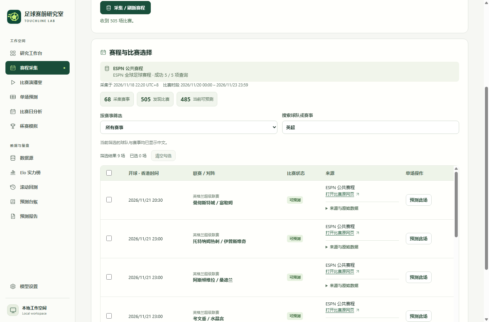

# Touchline Lab｜足球赛前研究室桌面版

把足球预测 skill 的采集、分析、比赛动画、报告与复盘放到同一个中文工作台。可使用本机预测引擎，也可在设置中接入自己的大模型 API。

## 下载

[下载最新 Windows 64 位便携版](https://github.com/nnnnompipo-glitch/football-match-prediction-skill/releases/latest)

推荐下载发布页中的 `TouchlineLab-2.2.0-windows-x64.zip`，解压后双击 `TouchlineLab.exe`。程序会打开本机浏览器页面，无需安装 Python；关闭桌面控制窗口即可退出服务。也可直接运行独立 EXE。版本附件同时提供 `SHA256SUMS.txt`。

升级时先关闭旧版，再启动新版并刷新赛程。设置与预测台账保存在 `%LOCALAPPDATA%\FootballForecastStudio`，便携包不包含用户的模型密钥或本机记录。

## 主要功能

- **自动采集比赛**：设置开始、结束时间，从实际收集的赛程中选择单场、多场或全部可预测比赛。默认使用 ESPN 公共赛程，也支持已有凭据的 Football-Data.org。
- **中文显示与搜索**：球队、赛事、阶段均有中文显示，支持“英超”“巴甲”“曼城”“大巴黎”等简称和来源原名搜索。赛事按来源编号区分。冷门名称先显示标明待核验的中文音译，并在后台尝试补齐通行译名。
- **比赛动画**：22 名球员的传球、跑动、抢断、射门、扑救及进球庆祝，支持重播、倍速、进度跳转和合成欢呼。比分抽样采用当前预测分布，场面属于生成的比赛演绎。
- **可选择的分析模块**：历史战绩、阵容伤停、赔率对照、情景重算、比分矩阵、晋级概率、杯赛模拟、Elo、回测、校准与冻结台账。
- **模型设置**：填写兼容 Chat Completions 的服务地址、模型名称与 API Key。AI 可解读报告并批量补译名称；数值预测、模拟和本地复盘可不依赖模型服务。
- **来源回溯与导出**：每场保留来源网页、原始接口、原名及采集时间，报告支持 HTML／JSON 导出。



完整操作见[使用说明](使用说明.md)。赛程按香港时间（UTC+8）筛选，巴西等地区当地晚间比赛通常位于北京时间次日清晨。来源未覆盖或未返回的比赛不会被当作已采集比赛。

## 中文覆盖检查

2.2.0 对 675 场真实赛程中的 80 种赛事名称、1,007 个球队名称和 31 种阶段名称进行断网显示检查，全部有中文。其中 823 个球队名称命中内置译名，184 个采用标注“音译待核验”的临时译写。自动音译可能与通行译名不同，原名始终保留。

检查记录：[完整覆盖报告](reports/name_coverage_after.json)。20 项 Python 回归和 10 项界面场景已通过，包含网络／模型失败、后台补译、筛选与勾选保留及队列关闭。

## 从源码运行

Python 3.10 或以上版本；服务与预测引擎使用标准库。从仓库根目录运行：

```shell
python football-studio/server.py --open
python -B -m unittest discover -s football-studio/tests -v
```

在安装了 PyInstaller 6 的 Windows Python 环境中重新构建单文件程序：

```shell
python football-studio/build_windows.py
```

本目录内的预测引擎随桌面程序打包，原始 Codex skill 保留在仓库的 `football-forecast-lab` 目录。需要密钥的体育数据源使用各平台自己的凭据；大模型 API Key 不替代体育数据源授权。
